<div align="center">

# Join

**A kanban-style project management tool for small teams.**
Plan tasks, assign contacts and follow progress on a drag-and-drop board.

[](https://angular.dev)
[](https://www.typescriptlang.org)
[](https://supabase.com)
[](https://sass-lang.com)

**[Live demo](https://join.mschmitz-dev.de)** · use **Guest Log in** to try it without an account

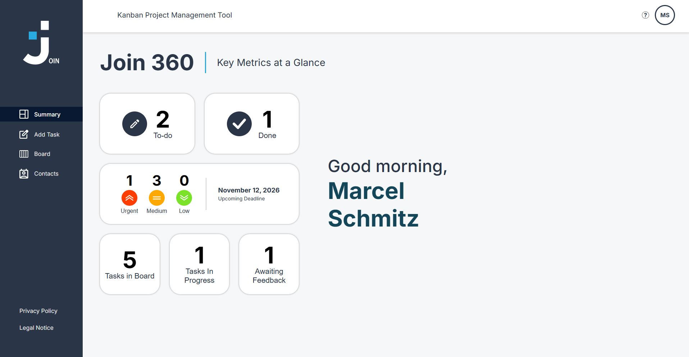
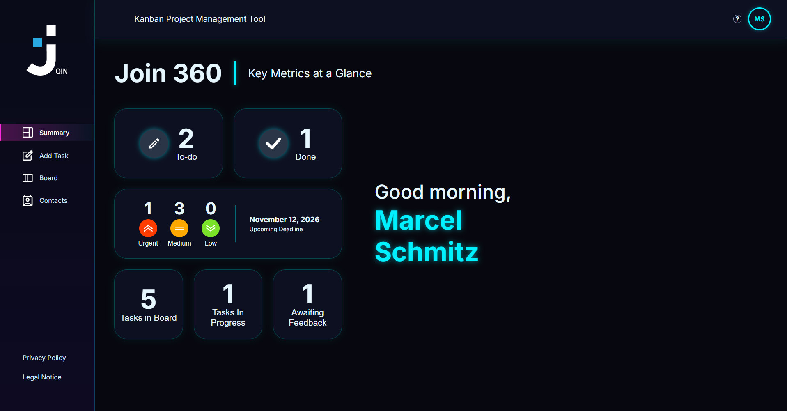

</div>

## About

Join was built as a team project during the web development training at the **Developer Akademie**. It follows the kanban method: work is split into small tasks that move through the stages *To do*, *In progress*, *Await feedback* and *Done*, so everyone can see at a glance what is going on.

The app uses Angular with standalone components and signals, and Supabase for authentication and the Postgres database.

## Features

- **Authentication**: sign up, log in, guest log in and deleting your own account (Supabase Auth)
- **Summary**: key metrics at a glance, such as tasks per stage, priorities and the next upcoming deadline
- **Board**: four columns with drag and drop (Angular CDK), live search, and a "move to" menu on touch devices
- **Tasks**: title, description, due date, priority, category, subtasks and assigned contacts, with an overlay for viewing, editing and deleting
- **Add task**: form with validation, custom date picker, category select and contact assignment
- **Contacts**: contact list grouped by initial, details view, create, edit and delete
- **Light and dark theme**: a neon dark theme in cyan and magenta
- **Responsive**: sidebar on desktop, bottom navigation on mobile
- **Legal pages**: legal notice and privacy policy, reachable without logging in

## Screenshots

|  | Light | Dark |
|---|---|---|
| **Board** | 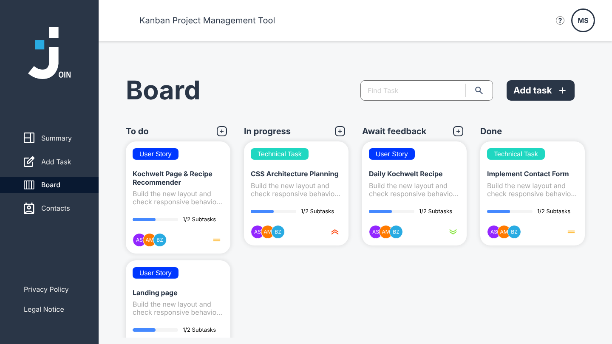 | 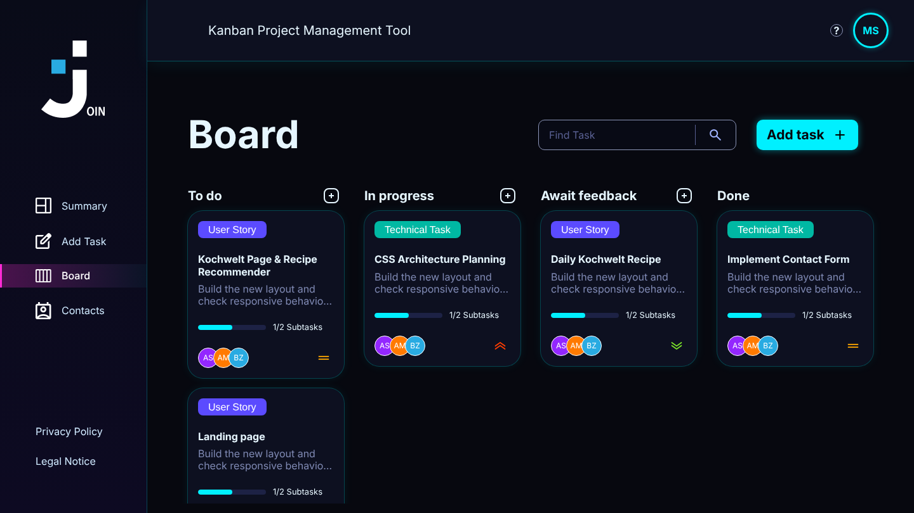 |
| **Add task** | 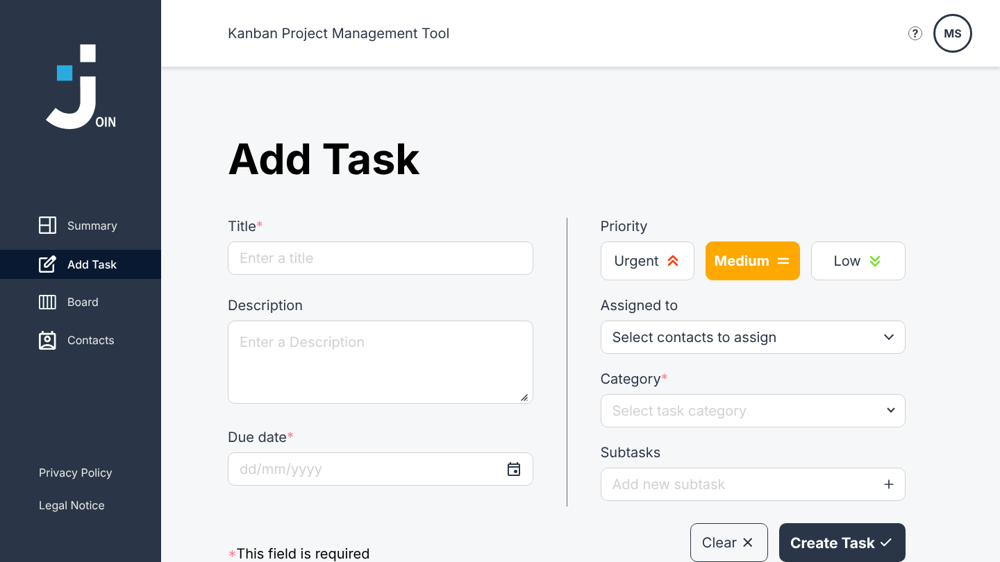 | 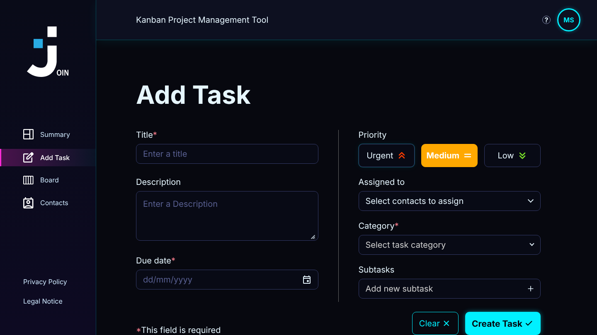 |
| **Contacts** | 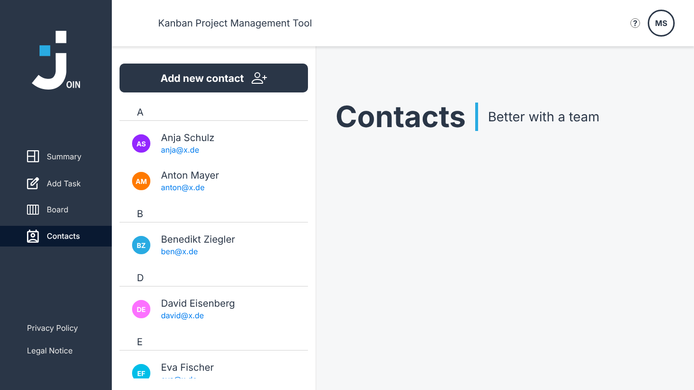 | 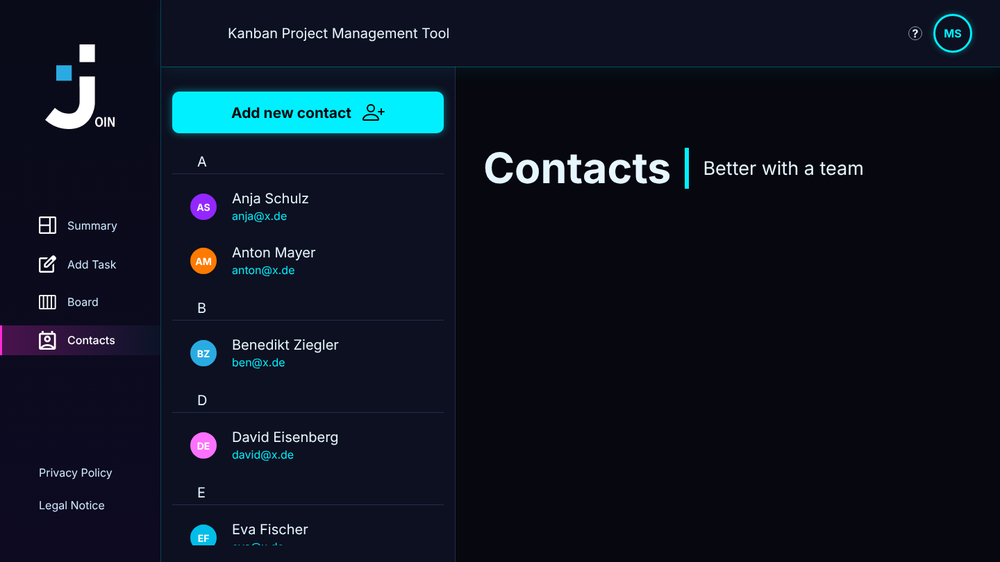 |
| **Log in** | 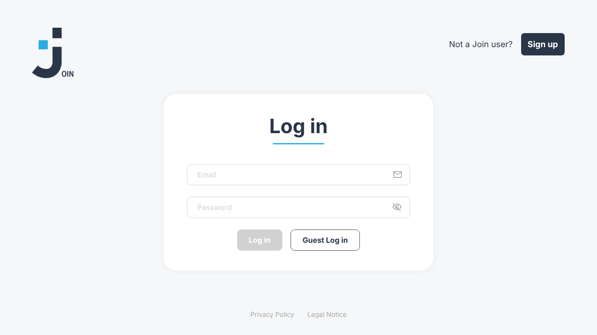 | 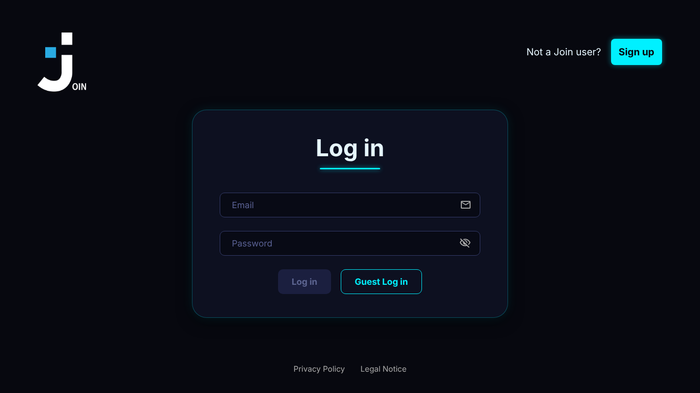 |

<details>
<summary>Mobile</summary>

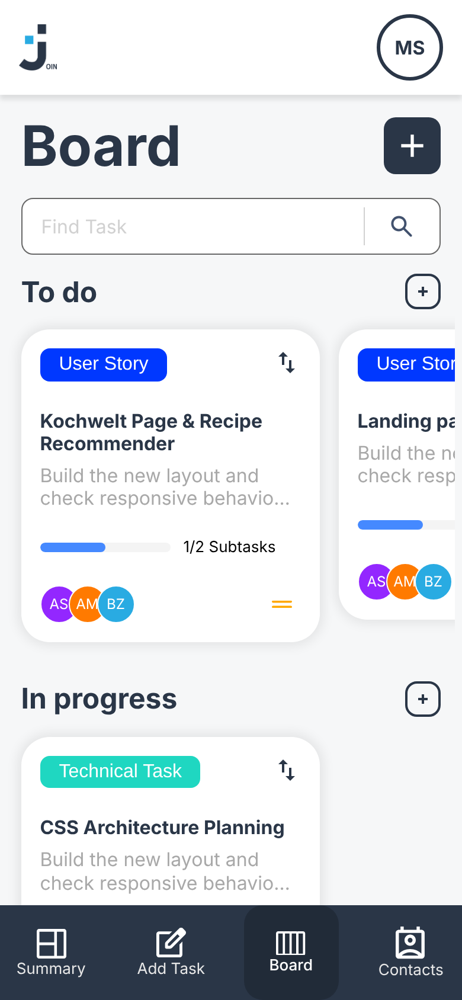
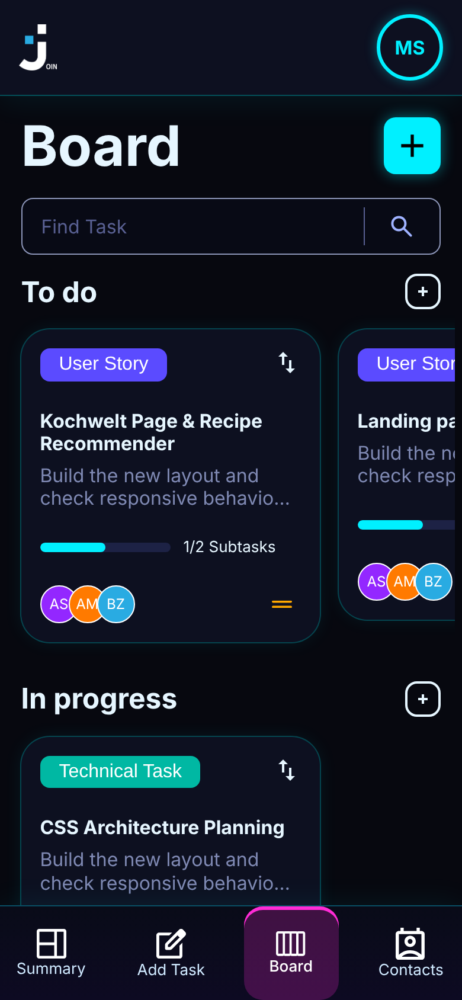

</details>

> The screenshots show sample data.

## Tech stack

| Area | Technology |
|---|---|
| Framework | Angular 22 (standalone components, signals, new control flow) |
| Language | TypeScript, SCSS |
| Drag and drop | Angular CDK |
| Backend | Supabase (Auth, Postgres, Row Level Security) |
| Tests | Vitest |
| Hosting | IONOS (static files) |

## Project structure

```text
Join/
├── public/                  static assets (icons, images, fonts, global styles)
├── src/
│   ├── app/
│   │   ├── dark-mode/       dark theme and theme switch
│   │   ├── features/        login, signup, summary, board, add-task, contacts, help,
│   │   │                    privacy-policy, legal-notice, drag-drop-tasks
│   │   ├── guards/          route guards (logged in / logged out)
│   │   ├── interface/       TypeScript interfaces
│   │   ├── service/         Supabase client, auth, tasks, contacts, summary stats
│   │   └── shared/          header, sidebar, main layout, toast, delete dialog
│   └── environments/        Supabase URL and publishable key
├── supabase/                SQL scripts for tables, policies and sample data
└── docs/screenshots/        images used in this README
```

## Getting started

### Prerequisites

- Node.js (current LTS) and npm
- a free [Supabase](https://supabase.com) project

### Installation

```bash
git clone https://github.com/<your-user>/Join.git
cd Join
npm install
```

### Connect Supabase

1. In your Supabase project, open the **SQL Editor** and run the scripts from the `supabase/` folder: `contacts.sql` first, then `tasks.sql`.
2. Enable **Authentication → Sign In / Providers → Allow anonymous sign-ins**. The guest log in needs it.
3. Enter your project URL and publishable key in `src/environments/environment.ts`:

```ts
export const environment = {
  supabaseUrl: 'https://<your-project>.supabase.co',
  supabasePublishableKey: '<your-publishable-key>',
};
```

> Only use the **publishable** key in the frontend. Never commit a secret or service role key.

### Run locally

```bash
npm start
```

The app opens at `http://localhost:4200`.

## Scripts

| Command | Description |
|---|---|
| `npm start` | development server with live reload |
| `npm run build` | production build into `dist/Join/browser` |
| `npm test` | unit tests with Vitest |

## Deployment

The production build is a static single-page app:

1. Run `npm run build`.
2. Upload the **contents** of `dist/Join/browser` to the web root of your domain (SFTP).
3. Make sure the included `.htaccess` is uploaded as well. It redirects deep links like `/privacy-policy` to `index.html` on Apache servers.
4. In Supabase, set **Authentication → URL Configuration → Site URL** to your domain.

## Theming

Join ships with a light theme and a neon dark theme. All dark theme styles live in `src/app/dark-mode/`, so they can be changed or removed without touching the rest of the app. The theme switch is a small easter egg: click the blue square in the Join logo.

## Privacy

Join is a demo and portfolio project. Please do not enter real personal data of third parties. How data is processed is described in the in-app **Privacy Policy** and **Legal Notice**.

## Team

| Name |
|---|
| Elias Hashimi |
| Marcel Schmitz |
| Christian Sobotta |
| Vincent Sonneck |

## License and credits

The design of Join belongs to the Developer Akademie GmbH. Source code and further content were created by the team members listed above. All rights reserved; the project is published for educational and portfolio purposes.
